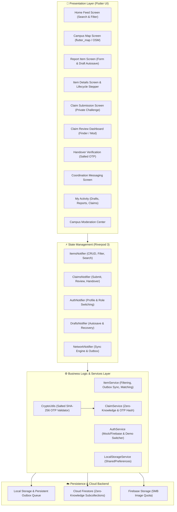
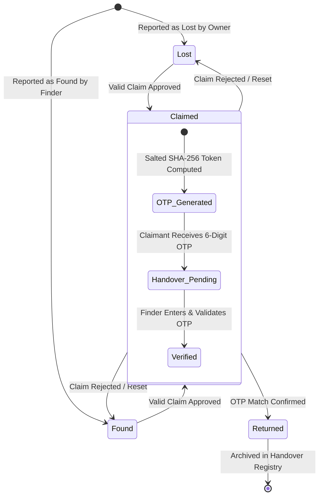
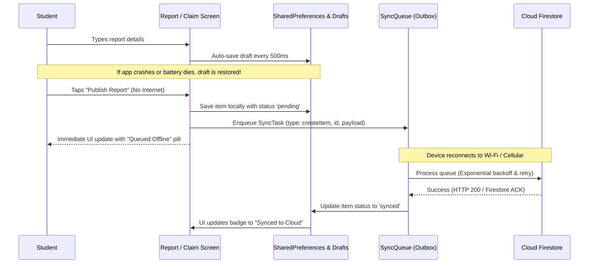

# Finders Keepers? — Campus Lost & Found System
### CodeChef-VIT Promotional Cycle 2026–27 | App Development Task

[](https://flutter.dev)
[](https://dart.dev)
[](https://riverpod.dev)
[-brightgreen)](file:///Users/kingpin/Documents/CC-Appdev/test)
[](file:///Users/kingpin/Documents/CC-Appdev)
[](#license)

---

## 📌 Executive Summary

**Finders Keepers?** is a production-grade, offline-first mobile application designed to solve the campus lost-and-found coordination problem across universities like **VIT Vellore**.

When items are lost or found in crowded campus hubs (SJT, Technology Tower, Central Library, Food Mall, Men's & Ladies' Hostels), conventional WhatsApp and noticeboard announcements cause chaos: fake claims, public spam, exposed personal numbers, and unverified handovers.

**Finders Keepers?** eliminates these issues through:
1. **Zero-Knowledge 3-Tier Ownership Verification**: Finders pose non-public challenge questions. Claimants submit proof and challenge answers stored in strictly isolated subcollections that are never exposed in public feeds.
2. **Cryptographically Salted SHA-256 Handover OTP**: Physical handovers are verified via a dynamic 6-digit one-time token visible only to the verified claimant. The database stores only a salted hash (`salt:itemId`), preventing unauthorized token forgery or snooping.
3. **Approximate Campus Geofencing**: Public listings show landmark names and approximate coordinates (protecting exact GPS lockers or desk positions).
4. **Resilient Offline-First Architecture**: Interrupted submissions are autosaved as drafts; network drops enqueue changes into a persistent local outbox with auto-retry and deduplication upon reconnection.
5. **Role-Based Access Control (RBAC)**: Comprehensive security rules for Students, Finders, and Campus Moderators.

---

## 🏗️ System Architecture

The application adopts a **Layered Architecture** powered by **Riverpod 3** `Notifier` / `NotifierProvider` reactive state management:



---

## 🗄️ Database Schema & Subcollection Hierarchy

### Firestore Collection Topology

```
/users/{userId}
  ├── id: string (matches auth.uid)
  ├── email: string (valid campus email)
  ├── displayName: string
  ├── studentId: string (e.g., 23BCE1001)
  ├── role: string ('student' | 'moderator' | 'admin')
  ├── phoneNumber: string (optional, masked in public views)
  └── createdAt: timestamp

/items/{itemId}
  ├── id: string (UUIDv4)
  ├── title: string (max 150 chars)
  ├── description: string (max 2000 chars)
  ├── category: string ('ID Cards & Docs', 'Electronics', 'Audio', 'Keys', 'Wallets', etc.)
  ├── type: string ('lost' | 'found')
  ├── status: string ('lost' | 'found' | 'claimed' | 'returned' | 'cancelled')
  ├── campusLocationName: string (e.g., 'Silver Jubilee Tower (SJT)')
  ├── campusZone: string ('Academic', 'Library', 'Dining', 'Hostels', 'Sports')
  ├── latitude: number (approximate campus coordinates)
  ├── longitude: number (approximate campus coordinates)
  ├── isApproximateLocation: bool (default true)
  ├── exactLocationDescription: string (visible only to verified parties)
  ├── imageUrl: string (optional photo URL)
  ├── reporterId: string (matches auth.uid)
  ├── reporterName: string
  ├── reporterContact: string (masked in public queries)
  ├── currentHolderId: string (delegated holder, e.g., Security Desk)
  ├── verificationQuestion: string (e.g., 'What is the sticker on the back?')
  ├── acceptedClaimId: string (UUID of accepted claim)
  ├── handoverCodeHash: string (SHA-256 of `salt:itemId:otp`)
  ├── handoverCompletedAt: timestamp
  ├── syncStatus: string ('synced' | 'pending' | 'failed')
  ├── createdAt: timestamp (immutable)
  └── updatedAt: timestamp
        │
        ├── /claims/{claimId}  <-- [ZERO-KNOWLEDGE SUBCOLLECTION]
        │     ├── id: string (UUIDv4)
        │     ├── itemId: string (matches parent itemId)
        │     ├── claimantId: string (matches claimant auth.uid)
        │     ├── claimantName: string
        │     ├── claimantContact: string
        │     ├── proofDescription: string (private non-public identifier)
        │     ├── answerToQuestion: string (private answer to challenge)
        │     ├── proofImageUrl: string (optional receipt/serial number photo)
        │     ├── status: string ('pending' | 'approved' | 'rejected' | 'handedOver' | 'cancelled')
        │     ├── rejectionReason: string (optional)
        │     ├── handoverCode: string (6-digit OTP visible ONLY to claimant)
        │     ├── createdAt: timestamp (immutable)
        │     └── updatedAt: timestamp
        │
        └── /messages/{messageId}  <-- [COORDINATION MESSAGING]
              ├── id: string (UUIDv4)
              ├── itemId: string
              ├── senderId: string (claimant or finder)
              ├── recipientId: string
              ├── text: string
              └── createdAt: timestamp

/reports/{reportId}  <-- [CAMPUS MODERATION]
  ├── id: string
  ├── reporterId: string
  ├── targetType: string ('item' | 'claim' | 'user')
  ├── targetId: string
  ├── reason: string
  ├── status: string ('pending' | 'investigating' | 'resolved' | 'dismissed')
  └── createdAt: timestamp
```

### 🔒 Why Subcollection Isolation is Essential

In Cloud Firestore, document-level security rules are all-or-nothing: if a user can read an `/items/{id}` document, they can read all fields within that document. Storing verification answers or claimant proofs directly inside the item document would leak them to any authenticated user querying the lost-and-found feed.

By structuring claims under `/items/{itemId}/claims/{claimId}`, Firestore security rules enforce:
```javascript
allow read: if isAuthenticated() && (
  resource.data.claimantId == request.auth.uid ||
  getItem(itemId).reporterId == request.auth.uid ||
  isItemHolder(getItem(itemId)) ||
  isModerator()
);
```
**Outcome**: Other campus students browsing the feed **cannot** query or read verification answers submitted by others, preventing claim sniping and privacy leaks.

---

## 🔄 Item Lifecycle & Handover State Machine



### Detailed Verification Steps

| Stage | Actor | Action & Security Enforcement |
|---|---|---|
| **1. Reporting** | Finder / Owner | Specifies approximate campus landmark (e.g. SJT, TT), category, and sets a **Private Challenge Question** (e.g. *"What is written on the keychain?"* or *"What is the lock screen wallpaper?"*). |
| **2. Browsing** | Students | Search by keyword, filter by category/status, or view campus map. Exact GPS and private answers are **not** visible. |
| **3. Claiming** | Claimant | Submits private challenge answers and proof description. Stored in `/items/{itemId}/claims/{claimId}`. Invisible to public queries. |
| **4. Review** | Finder / Moderator | Inspects claims in private Claim Review Dashboard. Reviews answers and taps **Approve** or **Reject** (with reason). |
| **5. Token Creation** | System | Upon approval, system generates a random 6-digit OTP (e.g. `482915`). The plaintext OTP is stored only in the claimant's approved claim document. The item record stores `SHA-256("salt:itemId:482915")`. |
| **6. Physical Handover** | Finder & Claimant | Parties meet at a designated public campus location (e.g. SJT Security Desk). Claimant displays the 6-digit OTP. Finder inputs the OTP into the **Handover Verification Screen**. |
| **7. Final Confirmation** | System | The entered code is salted and hashed with `itemId`. If the computed hash matches `handoverCodeHash`, the item transitions to `returned`, locking further edits and logging the timestamp. |

---

## 📶 Offline-First Synchronization Engine

Network connectivity across campus basements, auditoriums, and labs can be unreliable. **Finders Keepers?** implements an end-to-end offline engine:



### Resiliency Features
- **Draft Autosave & Restore**: The report screen continuously preserves form fields and selected campus landmarks. If interrupted, returning to the screen offers a *"Restore previous draft?"* prompt.
- **Idempotent Queue**: Each `SyncTask` carries a unique UUID and idempotency key, preventing duplicate records if a submission is interrupted during transport.
- **Visual Sync Badges**: Local changes display amber **Queued Locally** badges until server confirmation switches them to green **Synced**.

---

## 🗺️ Campus Mapping (OpenStreetMap + Leaflet)

- Uses `flutter_map` (v8.3.2) and `latlong2` centered on **VIT Vellore Campus** (`12.9698° N, 79.1559° E`).
- **Approximate Privacy Safeguard**: Pinpoints items to pre-defined campus landmarks:
  - Silver Jubilee Tower (SJT)
  - Technology Tower (TT)
  - Dr. M.G.R. Block
  - Central Library
  - Anna Auditorium & Amphitheatre
  - Food Mall & Gazebo
  - Men's Hostels (MH Blocks A–Q) & Ladies' Hostels (LH Blocks A–H)
  - Outdoor Sports Complex
- Exact locker numbers, seat numbers, and private contact details are withheld from map pins.

---

## 🛡️ Security Rules

### 1. Cloud Firestore Rules (`firestore.rules`)
- **Hardened RBAC**: Only users with verified moderator status or custom claims can access `/reports` or override item states.
- **No Self-Claim**: Reporters cannot claim their own reported items (`request.auth.uid != getItem(itemId).reporterId`).
- **No Promotion Exploit**: Users cannot alter their own `role` field on update.
- **State Transition Guard**: Items can only move through legal lifecycle transitions (`lost`/`found` ➔ `claimed` ➔ `returned`).
- **Validator Function Pattern**: All fields enforce strict upper bounds (e.g. `title.size() <= 150`, `description.size() <= 2000`).

### 2. Firebase Storage Rules (`storage.rules`)
- Authenticated read/write for item photos and claim proofs.
- File size capped at **5 MB**.
- Content-type whitelist restricted to `image/*`.

---

## ⚡ Instant Evaluator Demo Profiles

To facilitate friction-free evaluation without requiring manual account registration across multiple devices, the app includes a persistent **Demo Profile Switcher** on the Auth screen and in the drawer:

| Profile | Name | Role | Student ID | Use Case in Evaluation |
|---|---|---|---|---|
| **Profile 1** | **Aarav Sharma** | Student (Finder) | `23BCE1042` | Reported the lost Casio FX-991CW Calculator & MacBook Charger; reviews claims and validates OTP. |
| **Profile 2** | **Priya Patel** | Student (Claimant) | `23BCE2190` | Submits ownership claim for the Casio Calculator, answers challenge question, and receives the 6-digit OTP. |
| **Profile 3** | **Prof. Ramanathan** | Campus Moderator | `FAC20194` | Accesses the Campus Moderation Center, views disputed claims, and can override item statuses. |

---

## 🚀 Getting Started

### Prerequisites
- **Flutter SDK**: `3.47.7` or higher ([Install Guide](https://docs.flutter.dev/get-started/install))
- **Dart SDK**: `3.13.5` or higher
- **Web Browser**: Google Chrome or Chromium (for web preview)
- **Android SDK** (optional, for APK build): Platform 34+, Android Build-Tools 34.0.0, Java 17+

### 1. Clone & Install Dependencies
```bash
git clone https://github.com/codechef-vit/finders-keepers.git
cd CC-Appdev
flutter pub get
```

### 2. Run the Application

#### Option A: Run on Google Chrome (Instant Web Evaluation)
```bash
flutter run -d chrome
```
*Note: The project has also been pre-compiled into a release web bundle in `build/web`. You can immediately serve it locally:*
```bash
cd build/web && python3 -m http.server 8080
# Open http://localhost:8080 in your browser
```

#### Option B: Run on Android Emulator / Physical Device
```bash
flutter devices
flutter run -d <device-id>
```

#### Option C: Build Release Android APK
Ensure Android SDK and Java 17 are installed and configured (`ANDROID_HOME` exported):
```bash
flutter build apk --release
# Built APK will be available at: build/app/outputs/flutter-apk/app-release.apk
```

---

## 🧪 Automated Testing Suite

The repository includes a comprehensive automated test suite with **17 passing tests** covering cryptography, state machine transitions, zero-knowledge authorization, offline queues, and UI hierarchy.

```bash
flutter test
```

### Test Breakdown

| Test Suite | File | Tests | Coverage Scope |
|---|---|---|---|
| **Models & Crypto** | [`test/models_and_crypto_test.dart`](file:///Users/kingpin/Documents/CC-Appdev/test/models_and_crypto_test.dart) | 8 | Salted SHA-256 OTP generation, tampering resistance, wrong code rejection, JSON serialization, Haversine formula calculation, fuzzy search matching. |
| **Claims & Workflow** | [`test/claims_verification_workflow_test.dart`](file:///Users/kingpin/Documents/CC-Appdev/test/claims_verification_workflow_test.dart) | 8 | Zero-knowledge answer isolation, finder approval state transitions, handover OTP verification, illegal status transition blocking, offline outbox enqueuing, draft persistence. |
| **Widget & UI Smoke** | [`test/widget_test.dart`](file:///Users/kingpin/Documents/CC-Appdev/test/widget_test.dart) | 1 | App initialization, navigation bar tabs, search bar rendering, category filter chips, and seed item listing. |

### Static Analysis
```bash
flutter analyze
# Result: No issues found! (0 errors, 0 warnings, 0 lints)
```

---

## 📋 Task Sheet Acceptance Criteria Verification

| Requirement (Page 11) | Implementation Detail | Status |
|---|---|:---:|
| **Report lost/found items with descriptions, images, locations** | Implemented in [`ReportItemScreen`](file:///Users/kingpin/Documents/CC-Appdev/lib/ui/screens/report_item_screen.dart) with photo picker, categories, and campus landmarks. | ✅ Verified |
| **Search and browse reported items** | Implemented in [`HomeFeedScreen`](file:///Users/kingpin/Documents/CC-Appdev/lib/ui/screens/home_feed_screen.dart) with fuzzy search, category filter chips, and status tabs. | ✅ Verified |
| **Approximate item locations on a map** | Implemented in [`MapScreen`](file:///Users/kingpin/Documents/CC-Appdev/lib/ui/screens/map_screen.dart) using OpenStreetMap centered on VIT Vellore. | ✅ Verified |
| **Submit ownership claims** | Implemented in [`SubmitClaimScreen`](file:///Users/kingpin/Documents/CC-Appdev/lib/ui/screens/submit_claim_screen.dart) with challenge answers and private proof fields. | ✅ Verified |
| **Ownership-verification process before handover** | Implemented via 3-tier Zero-Knowledge workflow & [`HandoverScreen`](file:///Users/kingpin/Documents/CC-Appdev/lib/ui/screens/handover_screen.dart) with salted SHA-256 OTP tokens. | ✅ Verified |
| **Track items through lost, found, claimed, returned** | Visualized in [`LifecycleStepper`](file:///Users/kingpin/Documents/CC-Appdev/lib/ui/widgets/lifecycle_stepper.dart) and enforced by [`ItemService`](file:///Users/kingpin/Documents/CC-Appdev/lib/core/services/item_service.dart) & `firestore.rules`. | ✅ Verified |
| **Interrupted submissions & network unreliability** | Draft auto-saving and persistent offline outbox queue with retry in [`LocalStorageService`](file:///Users/kingpin/Documents/CC-Appdev/lib/core/services/local_storage_service.dart). | ✅ Verified |
| **Protect sensitive user information** | Subcollection isolation, masked contact numbers, zero public exposure of verification answers. | ✅ Verified |
| **Bonus: Smart Matching Recommendations** | Proactive recommendation engine in [`ItemService.getPotentialMatches`](file:///Users/kingpin/Documents/CC-Appdev/lib/core/services/item_service.dart). | ✅ Verified |
| **Bonus: Secure Coordination Messaging** | In-app finder-claimant messaging in [`ChatScreen`](file:///Users/kingpin/Documents/CC-Appdev/lib/ui/screens/chat_screen.dart). | ✅ Verified |
| **Bonus: Campus Moderation Dashboard** | Flagging and resolution system in [`ModerationScreen`](file:///Users/kingpin/Documents/CC-Appdev/lib/ui/screens/moderation_screen.dart). | ✅ Verified |

---

## 📄 Key Project Files

- **Architecture Decisions**: [`DECISIONS.md`](file:///Users/kingpin/Documents/CC-Appdev/DECISIONS.md) (in-depth rationale for technical choices, trade-offs, and limitations)
- **Security Rules**: [`firestore.rules`](file:///Users/kingpin/Documents/CC-Appdev/firestore.rules) & [`storage.rules`](file:///Users/kingpin/Documents/CC-Appdev/storage.rules)
- **State Management**: [`lib/providers/app_providers.dart`](file:///Users/kingpin/Documents/CC-Appdev/lib/providers/app_providers.dart)
- **Verification Engine**: [`lib/core/services/claim_service.dart`](file:///Users/kingpin/Documents/CC-Appdev/lib/core/services/claim_service.dart) & [`lib/core/utils/crypto_utils.dart`](file:///Users/kingpin/Documents/CC-Appdev/lib/core/utils/crypto_utils.dart)

---

## 📜 License
This project is authored for the **CodeChef-VIT Promotional Cycle 2026–27 App Development Task**. Distributed under the MIT License.
